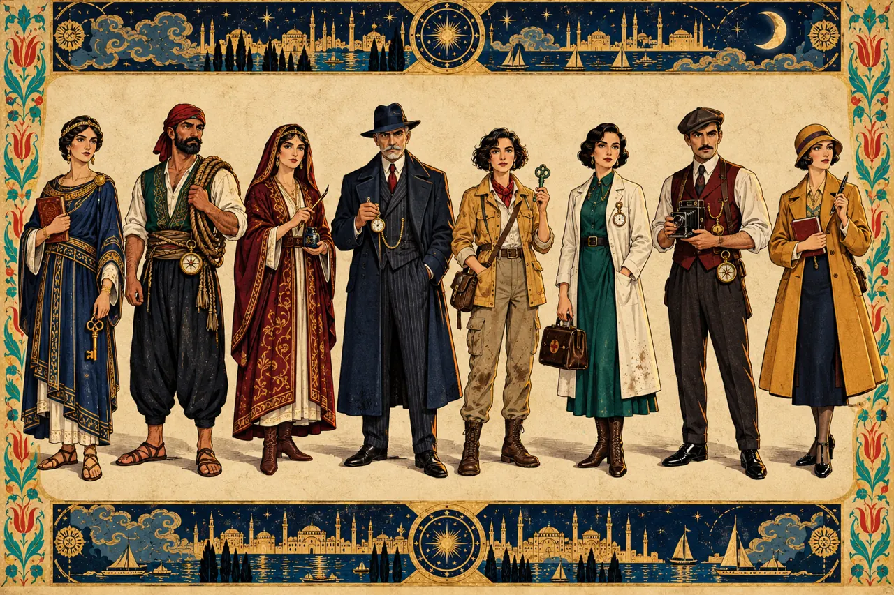

# MUAMMA: İstanbul'un Yedi Tılsımı · dijital prototip

**Hemen oyna:** https://emreaktepe.github.io/muamma/

İstanbul'un dört çağında (532, 1580, 1933, bugün) geçen, gizli hainli bir dedektif kutu oyununun tarayıcıda oynanabilir prototipi. Amaç, basılı sürümden önce kuralları dijitalde denemek, dengeyi ölçmek ve oyunu ekipçe anlamak.

DOT 101 Oyun Tasarımı ve Temelleri · Ekip ÇET



## Çalıştırma

Gereken: [Node.js](https://nodejs.org) 18 veya üstü.

```bash
npm install
npm run dev        # tarayıcıda http://localhost:5173 adresini aç
```

Windows'ta `Cannot find module @rollup/rollup-win32-x64-msvc` hatası alırsan `node_modules` klasörünü ve `package-lock.json` dosyasını silip `npm install` komutunu tekrar çalıştır (npm'in isteğe bağlı paket hatası).

| Komut | Ne yapar |
| --- | --- |
| `npm run dev` | Geliştirme sunucusu (kod değişince sayfa yenilenir) |
| `npm test` | Kural motorunun birim testleri |
| `npm run sim -- 300` | Botlarla her oyuncu sayısı için 300 oyun oynar, kazanma oranlarını tablo olarak basar |
| `npm run build` | `dist/` klasörüne yayınlanabilir sürümü üretir |

### İnternette yayınlamak (GitHub Pages)

Repoda `.github/workflows/pages.yml` hazır: `main` dalına her gönderimde testler çalışır ve site yayınlanır. Bir kez açmak için GitHub'da **Settings → Pages → Build and deployment → Source: GitHub Actions** seç. Adres `https://emreaktepe.github.io/muamma/` olur.

## Nasıl oynanır

- **Kurulum ekranında** 4–8 koltuk seç; her koltuk insan ya da bot olabilir. Aynı cihazda birden çok insan varsa gizli bilgiler "Yalnız X baksın" ekranıyla açılır. Herkesi bot yaparsan oyunu seyirci olarak izlersin.
- **Tohum** aynı kalırsa aynı roller ve aynı zar sonuçları gelir; bir oyunu tekrar etmek ya da hatayı yeniden üretmek için kullan.
- **Çırak modu** Gölge'yi kaldırır: tamamen işbirlikçi bir İstanbul turu.

Kısa kurallar oyun içindeki **Kurallar** düğmesinde, tam tasarım [storyboard dokümanında](https://claude.ai/artifact/WTYCCEKgBkny6hcbLCvD1D).

| Faz | Ne olur |
| --- | --- |
| Gün (×3) | Sırayla herkes 2 eylem: Yürü, Gizli İncele, Açık İncele, Sorgula, Bulmaca, Tılsımı Koru, Yetenek |
| Gece | Bekçi Vuruşu: Gölge suikast yapar, tılsım çalar ya da sahte iz bırakır |
| Sabah | Ceset, kayıp tılsım ya da sessiz bir gece |
| Divan | Ruh'lar rüya gösterir, vaka suçlaması yapılır, (bir kez) sürgün oylaması |
| Büyük Divan | IV. perdenin sonunda Delil Kutusu açılır, herkes Gölge'yi oylar |

## Kod yapısı

```
src/
  game/                  ← kural motoru: DOM'a dokunmaz, Node'da da çalışır
    engine.js            durum, eylemler, gece, Divan, kazanma koşulları, RULES ayarları
    ai.js                bot stratejileri (Muhafız ve Gölge)
    autoplay.js          bütün koltuklar botken oyunu ilerletir (simülasyon/test)
    data/
      locations.js       16 mekân, çağa göre adlar, tarih notları, yollar, tılsımlar
      eras.js            4 çağ
      characters.js      8 karakter, yetenekler, iz özellikleri
      cases.js           4 vaka: şüpheliler, ipuçları, tanıklar, bulmacalar, çözümler
  ui/board.js            SVG oyun tahtası
  main.js                ekranlar ve etkileşim
  styles.css             Minyatür Noir teması
public/assets/           ChatGPT görsellerinin web sürümleri (WebP)
tests/engine.test.js     birim testleri
scripts/simulate.js      denge simülasyonu
scripts/ui-smoke.mjs     tarayıcıda uçtan uca deneme (Playwright)
docs/TASARIM_NOTLARI.md  simülasyon bulguları ve açık tasarım soruları
```

**Yeni vaka eklemek** için `src/game/data/cases.js` içine aynı biçimde bir vaka yaz. **Kuralları değiştirmek** için `src/game/engine.js` başındaki `RULES` nesnesini düzenle ve `npm run sim` ile etkisini ölç.

## Durum

v0.1, oynanabilir ilk prototip. Bilinen eksikler ve sıradaki adımlar [docs/TASARIM_NOTLARI.md](docs/TASARIM_NOTLARI.md) içinde.

Görseller ChatGPT ile üretildi. Fontlar: Cinzel, Cormorant Garamond, Courier Prime (SIL Open Font License). Vakalardaki katil, kurban ve şüpheliler kurgusaldır; tarih notları gerçek bilgilerdir.
